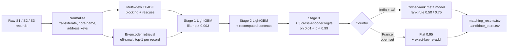

# Ship It Friday — ML Challenge 2026: Business Entity Resolution


Links business records from **Source 2** and **Source 3** to the **Source 1** entity they belong to (or to none),
across India, the US and France. France has no training labels.

**Team:** Prajjwal Singh · Gaurav Tiwari · Harshi Singh · Tushar Singh Akhawat

---

## Highlights

| | |
|---|---|
| **Public leaderboard (macro F0.5)** | **0.987133** |
| India + US, out-of-fold at test density | 0.991349 (precision 0.99825, recall 0.97655) |
| France, leave-one-country-out (unseen US / unseen India) | 0.98304 / 0.96808 |
| Candidate pairs on test | 8,263,584 (**4.77 per Source-1 entity**) |
| Matches submitted | 5,860,665 |

- **Two candidate sources:** multi-view TF-IDF blocking plus a supervised multilingual bi-encoder. The bi-encoder
  recovered 61,693 true matches that lexical blocking missed.
- **Learned candidate filter:** stage-1 LightGBM cuts ~22 pairs per entity to 4.77 with no loss in F0.5, so
  `candidate_pairs.tsv` is exactly the set we scored.
- **Cascaded matching:** cross-fitted LightGBM stages with competition/context features, three fine-tuned
  cross-encoders (e5-small ×2, e5-base) and an owner-ranking meta model. The final decision keeps one owner per record.
- **Open-set France:** the same chain, trained only on India + US labels, with a precision-first threshold. It was
  validated by holding out one country at a time.
- **Validated at test density:** the test has about 2× more unmatched records than training, so every validation
  number is measured on a "corrected 2×" pool that matches it.

## Pipeline



### What each stage added (India + US, out-of-fold)

| System | Candidates / S1 | F0.5 at 1× | F0.5 at corrected 2× |
|---|---|---|---|
| Lexical blocking, full candidate set | ~21 | 0.98938 | 0.98867 |
| + learned candidate filter | 4.6 | 0.98937 | 0.98870 |
| + learned retrieval | 4.7 | 0.99165 | 0.99118 |
| + retriever features in all stages + meta model (**final**) | 4.6 | **0.99180** | **0.99135** |

## Repository layout

```
.
├── README.md                          ← you are here
├── Documentation_template.md          full solution write-up (analysis, method, results, error analysis)
├── code/business_entity_resolution/
│   ├── README.md                      environment, code map and exact run order
│   ├── requirements.txt               pinned versions
│   └── src/
│       ├── *.py                       core library: normalise, block, features, LightGBM, cross-encoders, decide
│       └── final/                     final-system steps (retrieval, pass 2, India+US cascade, France chain, export)
└── output/                            final submission files (gitignored; large)
```

## Quick start

```bash
python -m venv .venv && source .venv/bin/activate      # Windows: .venv\Scripts\activate
pip install -r code/business_entity_resolution/requirements.txt
pip install torch==2.14.0 --index-url https://download.pytorch.org/whl/cu126   # CUDA build
```

Put the competition data under `dataset/` next to `code/`:

```
dataset/train/{train_source1,train_source2,train_source3,train_ground_truth}.tsv
dataset/test/{test_source1,test_source2,test_source3}.tsv
```

Then run the 9 steps in
[code/business_entity_resolution/README.md](code/business_entity_resolution/README.md#run-order-exact-commands),
from pass 1 to `make_final.py`. Run every command from the repository root. In short:

| Step | What it does | Approx. time |
|---|---|---|
| 1 | Pass 1: normalise, block, features, LightGBM stages, two e5-small cross-encoders | 5–7 h |
| 2 | Build the corrected-2× validation pool | 1–2 h |
| 3 | Third cross-encoder (e5-base) + stage-3 integration | 3–4 h |
| 4–5 | Mine hard negatives; train two bi-encoders; retrieve candidates | ~1.5 h |
| 6 | Pass 2 with retrieval candidates + its 2× pool | ~4.5 h |
| 7 | India + US cascade, owner-rank meta model, export | ~2 h |
| 8 | France open-set chain + exact-key re-add | ~1 h |
| 9 | Merge into `output/` and validate | minutes |

**Reference hardware:** Windows 11, 16 CPU threads, 64 GB RAM, one NVIDIA RTX 4090 laptop GPU (16 GB). Run one GPU
job at a time. Re-running steps 7–9 reproduced both output files byte-for-byte; see the package README for checksums.

## Compliance

- Uses only the provided `dataset/` files: no external registries, business databases, geocoding APIs or commercial
  entity-resolution services.
- The pretrained `intfloat/multilingual-e5-small` and `-base` checkpoints (MIT) are fine-tuned only on the provided
  training pairs.
- No parameter or threshold is fitted on test data: no pseudo-labels, no self-training.
- France models are trained only on India + US labels, and all countries run through the same code.

## Further reading

- [Documentation_template.md](Documentation_template.md): problem analysis, features, model details, error analysis
- [code/business_entity_resolution/README.md](code/business_entity_resolution/README.md): exact commands, measured
  results, output checksums
